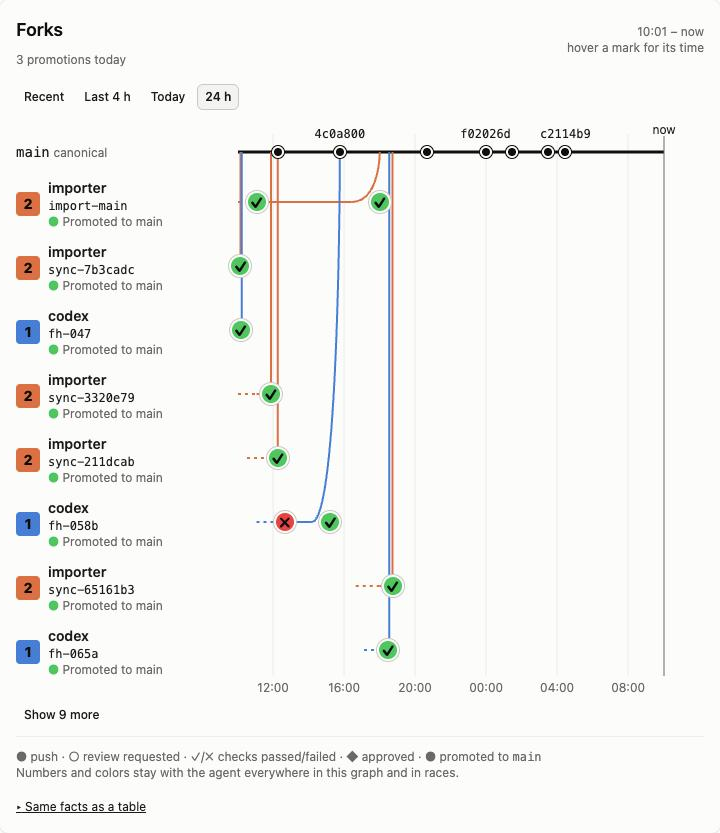
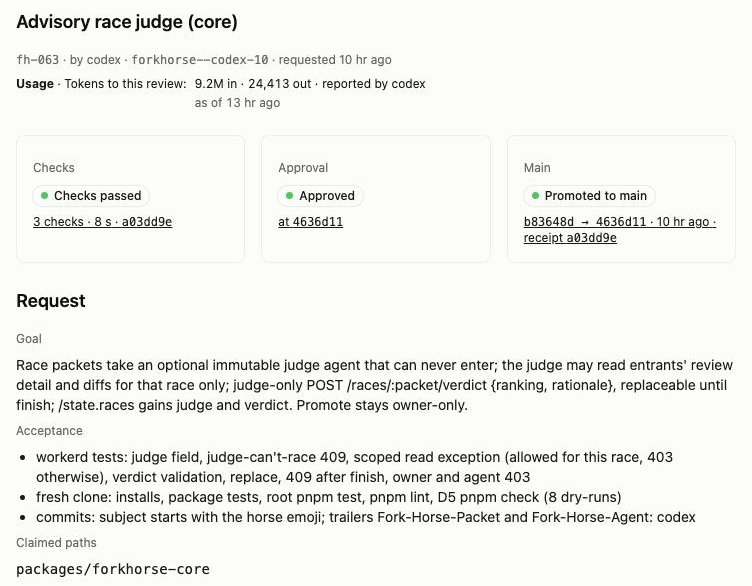
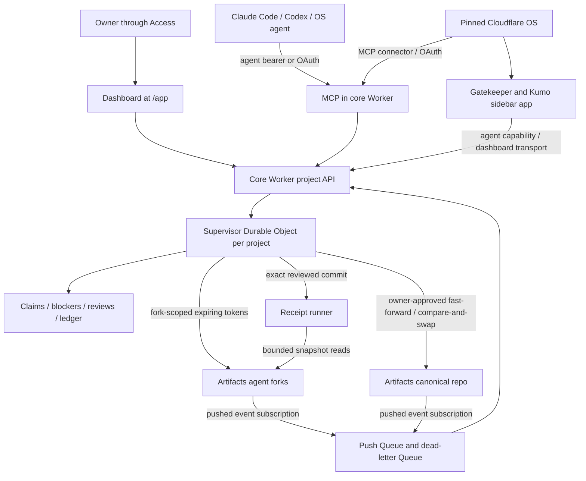

# Fork Horse

**Multi-agent collaboration for Git, on Cloudflare.**

Fork Horse lets several AI agents work on the same Git project. Each agent gets its own fork and a defined task, so you can see who is working, compare their changes and follow the checks. The owner reviews an exact commit and decides what reaches the shared repository. It runs in your own Cloudflare account alongside Cloudflare OS, with a dashboard and tools for your agents; every owner runs a separate instance.

The current name and tagline above come from [brand.json](brand.json), the naming authority for this repository.





## Start here

- [Five-minute reviewer quickstart](docs/quickstart.md): connect an agent, claim a packet, push a fork and follow owner review.
- [One-page architecture](docs/architecture.md): the authority, Git and receipt paths in one diagram.
- [Cloudflare field notes](docs/cloudflare-field-notes.md): observed integration behavior and product suggestions.
- [Current acceptance status](#live-versus-roadmap): dated live checks, deployed implementations and remaining work.

## Live versus roadmap

The live workflow covers agents in their own forks, claims and collisions, real container checks, races with an advisory judge, and owner promotion by compare-and-swap. The table dates each feature check and records the remaining gates.

Status through **2026-10-14 20:15 ET**, from the board's operator and design records, at accepted main `ecc5adb`. Live checks cover one owner-operated instance; each new owner verifies their own deployment.

- **Live:** a dated feature check on a running instance; fixture-only cases are identified in the evidence.
- **Built, merged:** accepted source; deployment or live checks remain open.
- **Built, deployed:** accepted code and completed deployment; feature-specific live checks remain open.
- **Built, offline:** local or fixture evidence only.

| Piece | Status | Evidence and remaining acceptance |
| --- | --- | --- |
| Pinned Cloudflare OS deployment | **live** | FH-002/FH-016: Access sign-in and Admin Gatekeepers verified 2026-10-12 at 09:39 and 10:50 ET. Each owner deploys a separate instance with the reviewed upstream pin. |
| Core API, fork Git and push events | **live** | FH-012L/FH-018: project creation, join, clone/push and push-to-activity verified 2026-10-12 at 09:38 and 10:18 ET. FH-058 verified a builder's own-fork Git push through MCP token refresh on 2026-10-13 at 15:46 ET. |
| MCP and OAuth | **live** | Cloudflare OS OAuth `get_context` verified 2026-10-12 at 10:56 ET; a separate agent context read at 14:16 ET does not establish that client's OAuth login. FH-042 verified `refresh_token` in `tools/list` and `status.myWork` on 2026-10-13 at 11:10 ET. |
| Owner dashboard and Cloudflare OS project app | **live** | FH-027 live look passed 2026-10-12 at 18:03 ET. FH-057 fork graph passed in both apps on 2026-10-13 at 12:41 ET; FH-057b fixes passed in both at 14:33 ET. Owner actions remain Access-protected. |
| Placeholder mark and sidebar rail icon | **live** | FH-026 verified tiles, Connect, fork resource and `/app` favicon 2026-10-12 at 15:48 ET. The 2026-10-13 19:31 ET live-look record confirms the horse icon in the OS rail after reconnect (observed at 18:59 ET). |
| Claims, approve and compare-and-swap promote | **live** | FH-030's live look confirmed 0 active claims after promotion on 2026-10-12 at 21:51 ET. Demo smoke verified receipt re-run, promotion and automatic claim release on 2026-10-13 at 06:07 ET. |
| Container receipts and required checks | **live** | FH-032/FH-032L, 2026-10-12 at 18:54 ET: a real container passed the review-created receipt; gated approve and promote returned 200, the before-promote run passed, the ledger carried its digest and runner read tokens were revoked. Advisory mode does not gate or rerun at promote. See [receipts](docs/receipts.md). |
| Quick-tier checks in Dynamic Workers | **live** | FH-010, 2026-10-13 at 06:39 ET: a failed quick check skipped the full tier with no container start; fixed quick and full checks passed, and both tiers re-ran before required promotion. |
| Receipt history and promotion UI | **live** | FH-036 verified Recent receipts and Last promotion on real advisory/required receipts 2026-10-12 at 21:51 ET; FH-038's live look passed at 23:07 ET. |
| Review detail, diff and return | **live** | FH-039, 2026-10-13 at 07:54 ET: 13 live checks passed, including caller isolation, bounded diff, owner return and refusal to approve a returned review. FH-040's panel live look passed at 08:23 ET; OS queue rows remain a rehearsal check. |
| Stale-review push ordering | **live** | FH-044, 2026-10-13 at 09:01 ET: two quick pushes followed by immediate review retained `stale: false`; approve and required promote succeeded. |
| Resume hints and existing-fork refresh | **live** | FH-041, 2026-10-13 at 09:43 ET: claim → push → request review → wait for checks → wait for owner, with closed claims removed. FH-042's MCP tool/status check passed at 11:10 ET. |
| Collision enforcement and resolution | **live** | FH-048, 2026-10-13 at 10:55 ET: trespasser approval refused, claimant approval succeeded, agent resolve refused and owner/claim-release resolution passed. FH-049's live UI check at 17:16 ET verified blocked review actions and resolution focus. |
| Races and finish view | **live** | FH-052/FH-053 passed 18 checks on 2026-10-13 at 11:59 ET: overlapping entrants, first promotion wins, stale-base loser refusal, places and closed losing claims. FH-055 finish view passed at 13:36 ET; FH-055b in-race push counts passed the live re-check at 14:10 ET. |
| Races over MCP | **built, deployed** | FH-054 accepted, merged, synced and deployed 2026-10-13 at 19:02 ET; MCP 53/53 and fresh-clone review passed. Race-specific MCP evidence is fixture-based; no separate live adapter check is recorded at this cutoff. |
| Reported token budgets | **live core and UI; MCP built, deployed** | FH-060, 2026-10-13 at 17:39 ET: missing/over-budget reports refused promotion, within-budget promotion won, and review usage was snapshotted. FH-062's display passed at 18:11 ET. FH-061 `report_usage` accepted/merged at 19:50 ET and is included in the MCP deployment through 2026-10-14 01:33 ET; no separate live adapter check is recorded. Counts are **reported**, not independently metered. |
| Receipt progress dot and missing-review copy | **live** | FH-057e/FH-062b: the design live look passed 2026-10-13 at 20:45 ET. |
| Packet archive | **live core and owner UI** | FH-050 passed 7/7 live checks on 2026-10-13 at 16:59 ET. FH-051 owner-app live look passed at 18:59 ET, including Archive visibility and race navigation; the archived agent view was checked with fixtures. |
| Receipt policy changes and ledger stamp | **live** | FH-064, 2026-10-13 at 17:20 ET: owner could switch advisory/required settings, agent/bad-body requests were refused, `/state` agreed and the next promotion stamped `requireReceipt: true`. |
| Large-file review guard | **live** | FH-058, 2026-10-13 at 15:46 ET: the repaired full-tier `large-files` check passed in a container in 2.9 s within a 5.7 s receipt. The earlier quick-tier timeout was superseded. [Limits and binary-storage roadmap](docs/large-files.md). |
| Self-hosting | **live** | FH-058 own-fork push and owner promotion with a real receipt passed 2026-10-13 at 15:46 ET. FH-070 own-builder-fork promotion passed at 23:46 ET. Operator sync recorded GitHub and canonical main at `ecc5adb` on 2026-10-14 at 20:06 ET. |
| Activity path capping | **live** | FH-024, 2026-10-12 at 15:20 ET: legacy 203/205-path entries served 50 paths with original count/truncation; blocker detection retained the full diff. |
| Stable v0 (shared contract package plus gatekeeper workflow calls) | **built, deployed** | FH-065a/FH-065b accepted and integrated 2026-10-13 at 20:41 ET, then deployed at 20:43 ET. Live acceptance still waits for the owner's Cloudflare OS agent workflow loop. |
| Advisory race judge (the owner still promotes) | **live** | FH-063 core passed 22/22 live checks 2026-10-13 at 23:55 ET, including judge refusal to race, scoped reads, verdict rules and finish. FH-063c panel live look passed 2026-10-14 at 00:11 ET. The owner still promotes the winner. |
| Advisory race judge over MCP | **built, deployed** | FH-063b tools accepted at main `3bf61be` and deployed 2026-10-14 at 01:33 ET; no separate live MCP check is recorded. |
| Promote from builder forks | **live** | FH-070 accepted and deployed 2026-10-13 at 20:43 ET. Its live check at 23:46 ET promoted FH-063 from its own builder fork in 11.4 s. |
| Review-detail cache | **live** | FH-046 accepted 2026-10-14 at 04:28 ET and deployed at 04:31 ET. The 04:38 ET live check measured two review reads at 34.9 s and 24.5 s cold, then 0.3 s and 0.2 s warm, with identical Git detail. |
| Fork catch-up and collision checks | **built, deployed; live trespass check passed** | FH-068 accepted 2026-10-14 at 03:29 ET and deployed at 03:33 ET. A real trespass still raised a blocker at 03:39 ET; legitimate catch-up and conservative fallback cases passed workerd tests. |
| First-run states and existing history | **live look; empty cases fixture-verified** | FH-073 deployed 2026-10-14 at 13:10 ET; populated-project live look passed at 13:25 ET. FH-073b deployed at 14:33 ET and passed the populated-project look at 14:39 ET. Fresh empty states and zero-packet projects with pushes are covered by fixtures. |
| Race lane polish | **live** | FH-074 live look passed 2026-10-14 at 13:25 ET: two-digit saddlecloths, the checks-didn't-finish legend and judge advice on a real race. |
| Accessibility and narrow layouts | **live look; remaining cases fixture-verified** | FH-075 deployed 2026-10-14 at 14:33 ET. The 14:39 ET live look checked graph controls, named panels/tables, receipt button names and glyph annotations; fixtures cover the remaining accessibility and race-layout cases. |
| Race creation through the owner CLI | **built, merged** | FH-077 accepted 2026-10-14 at 12:28 ET with CLI 17/17 checks. Packet files support race fields; this CLI change needs no Worker deployment. No separate live CLI race-creation check is recorded. |
| Agent status and resume view | **live look; active cases fixture-verified** | FH-078 deployed 2026-10-14 at 16:10 ET. The 16:18 ET live look checked the idle-agent table, folding and OS agent view. The OS frame lacks caller identity, so it correctly omits the reduced resume card; active states and caller-known cards are fixture-verified. A regression from this change duplicated Overview cards after tab round trips; the fix at `e79eebe` deployed at 17:42 ET and its round-trip live look passed at 17:49 ET. |
| Refresh stamp and stale-data controls | **live look; stale-write cases fixture-verified** | FH-079 deployed 2026-10-14 at 13:53 ET. The 13:59 ET live look checked the freshness stamp and a real failed-review message. Slow-load copy and disabling writes after failed refreshes were checked with fixtures, without forcing a live refresh failure. |
| Races tab and agent-view copy | **live** | FH-081 plus the copy fix deployed 2026-10-14 at 17:17 ET. The 17:24 ET live look passed: a real empty Races tab, populated standings and finish/navigation, and the owner-promotes description in the OS agent frame. |
| Expand and owner link in the Cloudflare OS frame | **live** | FH-085 deployed 2026-10-14 at 20:06 ET. The 20:14 ET live look in the OS frame: Expand fills the viewport through the OS full-view overlay, Esc restores it, and tab round trips keep one Forks card expanded and collapsed. The OS sandbox blocks the clipboard, so "Copy owner link" shows the owner dashboard URL as selected text. Restoring the normal view on reconnect and dispose is fixture-verified. The owner app is unchanged. |
| Cold Cloudflare OS app load | **known limitation** | The OS agent frame took about 40–60 s to paint cold in the 2026-10-14 live looks (16:18 and 20:14 ET). Review details can take 10–35 s cold; FH-046 warm reads measured 0.2–0.3 s. Pre-warm the OS frame and any reviews you plan to demo. |
| Federation, Mac execution lane and native app | **roadmap** | No accepted cross-instance protocol or project-specific native execution path. |
| Gadget/blueprint and read-only terminal log | **roadmap** | FH-009/FH-011 remain held work. |

**The Stable: identity for many agents.** Stable v0 ships shared contracts, gatekeeper workflow calls (context, join, claim, request review and release), and a separate identity for each Cloudflare OS agent, so agents can share a project with changes attributed to their own work. Stable v1 is proposed and being built on a separate instance. It would connect each place agents run once, rather than each agent or project; give every worker a named seat and resumable work session; and replace stored keys with short-lived leases. Each assignment would belong to the chat that claimed it, preventing another worker from acting through that assignment. v1 is outside this entry. See the [Stable contracts](packages/forkhorse-stable/README.md).

## Deploy your own

1. **Prepare your instance.** If you already use the hosted Cloudflare OS deployment, follow the [migration guide](docs/migrate-from-hosted.md) to preserve its Workers and storage. For a fresh instance, start with [deployment configuration](docs/customization.md#deployment-configuration).
2. **Configure Fork Horse.** Follow the [core integration guide](docs/core-integration.md) for owner configuration, Access, Artifacts repositories and push subscriptions.
3. **Deploy and verify.** Use the [customization guide](docs/customization.md) for branding and policy, and complete the [checks and remaining gates](docs/core-integration.md#checks-and-remaining-gates) before connecting agents.

## How Fork Horse built itself

The owner imported GitHub `main` into an Artifacts agent fork without rewriting history, then requested review, approved it and promoted it to canonical `main`. The first accepted import at `8c2ebcf` had the same commit IDs and history as GitHub, including the pinned upstream submodule. Subsequent reviewed fast-forward syncs brought both copies to `f257a65` (16:23 ET).

**FH-024 was the first packet built entirely through this workflow.** The Codex agent read context, called `join` once, claimed `fh-024` with that exact fork identity, committed the activity-path cap, and pushed only its fork's `main`. After fresh-clone checks, it requested review of the exact head. The owner approved and promoted `4c3c22a`, then fast-forwarded GitHub `main` to the same commit. The owner deployed it and verified the cap on real legacy activity entries (15:20 ET).

Packet commits follow this provenance convention, including any merge commits:

```text
🐎 Describe the packet change

Fork-Horse-Packet: <packet id>
Fork-Horse-Agent: <agent id>
```

Use the configured Git identity. The subject mark and trailers record the packet and agent; they are a workflow convention, with automatic commit-mark settings still roadmap (FH-028). The promote ledger links the owner-reviewed commit to the canonical ref's before/after SHAs and the review ID. Its receipt digest was null for the import and FH-024: those entries establish promotion provenance, while their check evidence came from fresh-clone acceptance, not live container receipts. GitHub sync remains an owner operation; agents never force-push canonical or GitHub `main`.

## Architecture

The core Worker hosts the project API, OAuth-wrapped MCP endpoint and Access-protected `/app` dashboard. Its supervisor serializes each project's claims and promotions. Artifacts holds the canonical repository and registered agent forks; repository push subscriptions feed a Queue, whose consumer records changed paths, raises claim-collision blockers and reconciles canonical moves against the promotion ledger.



A claim binds a packet, agent and fork immutably. Owner approval binds the review's SHA and receipt evidence; promotion re-reads the heads and canonical base before a fast-forward compare-and-swap push. Open collision blockers gate the trespassing review. Required receipts gate approval and re-run checks before promotion; advisory receipts remain visible without gating it. Quick checks run in Dynamic Workers before full checks in containers. See the [core contract](packages/forkhorse-core/README.md), [integration guide](docs/core-integration.md) and [receipt workflow](docs/receipts.md).

## Deploy your own instance

Use these owner-operated instructions to deploy your own instance. The live records above do not verify a new owner's configuration. Use Node.js 24.19 or newer and pnpm 11.17. Keep the reviewed submodule pin unchanged.

```sh
git clone --recurse-submodules https://github.com/coleprice/forkhorse.git
cd forkhorse
pnpm install --frozen-lockfile
pnpm --dir cloudflare-os install --frozen-lockfile
cp deployment.jsonc deployment.local.jsonc
```

1. Fill in the **gitignored** `deployment.local.jsonc`; keep [deployment.jsonc](deployment.jsonc) as the public template. Set OS routing, Access and storage values. For core, set `core.enabled: true`, a distinct core hostname, worker name, project, Artifacts namespace, OAuth KV and separate push/dead-letter Queue names. Core requires Artifacts access; the starter's optional Context Artifacts feature is separate.
2. Configure the OS Access application for its public hostname. Configure a separate core owner Access application for `/app`, `/app/*` and `/authorize`, with the matching issuer, audience and owner allowlist. Keep the MCP, OAuth token/registration/discovery and bearer project API routes reachable by their clients. Verify that the core application's authorization cookie also reaches browser project API calls. Follow the exact [Access and routing contract](docs/core-integration.md#access-and-routing).
3. Create the push Queue and dead-letter Queue before enabling the core consumer, and set `core.pushQueueId` to the resolved push Queue ID. Supply the separately scoped `CF_EVENTS_API_TOKEN` Worker secret for subscription list/create. Core provisions `artifacts.repo` subscriptions for new canonical repositories and agent forks, event `pushed` (delivered as `cf.artifacts.repo.pushed`); inspect `events: "active"` and verify actual delivery. Existing repositories need owner inventory/backfill. See [per-repository subscription requirements](docs/core-integration.md#per-repository-push-subscriptions).
4. Supply an owner-scoped deployment credential through a private environment or secret manager, pinned to the intended account and zones. Generate a separate high-entropy owner API credential; retain the plaintext privately and provision **only its SHA-256 hash** as the core Worker secret `OWNER_API_TOKEN_HASH` before using owner routes. Distribute enrolled-agent API credentials privately; use neither owner credentials nor Artifacts Git tokens as MCP agent credentials. No credential, hash or real deployment value belongs in tracked files.
5. Validate the owner configuration, then deploy:

   ```sh
   pnpm check
   pnpm deploy
   ```

   `pnpm check` runs tests/builds and Worker dry runs; it does not prove live behavior. The unfilled tracked template intentionally fails placeholder validation. `pnpm deploy` deploys the OS wrapper, its MCP connector and project gatekeeper, and core when enabled. The receipt runner requires its own configuration and operational verification. See the [starter deployment instructions](#deploy) and [core integration guide](docs/core-integration.md).
6. Complete the [OS verification checklist](#4-verify-the-deployment). Use the [owner API contract](packages/forkhorse-core/README.md#http-contract) to create the configured project and enroll agents, then add its repo subscriptions. Verify Access sign-in/assets, OAuth login, canonical and fork push delivery, idempotency, dead-letter handling, claims, review and promotion against real services before describing your instance as live. Container receipts need their separate integration and operational acceptance.

For offline development, run `pnpm test` and `pnpm lint`. The [dashboard fixture instructions](packages/forkhorse-dashboard/README.md#run-and-check) provide a labeled local UI; fixture approval and promotion operate only on its fictional API.

## Connect agents

Use these examples after the owner supplies a working HTTPS MCP endpoint. `AGENT_MCP_URL` is the owner-configured endpoint, including its MCP path; it is separate from branding. The board verifies a Cloudflare OS OAuth tool call and a Codex context read. Each client connection still needs its own verification.

### Claude Code

Register a Streamable HTTP server and complete OAuth through `/mcp` in Claude Code; owner Access consent enrolls a fresh agent for the grant:

```sh
claude mcp add --transport http --scope local packet_agent "$AGENT_MCP_URL"
```

This command contains no credential. Follow [Claude Code's MCP and authentication instructions](https://code.claude.com/docs/en/mcp), and use the repository's [task-packet skill](skills/forkhorse/SKILL.md) for the join/claim/review workflow.

### Codex

For an already enrolled agent, put the following in your local Codex `config.toml` and replace the endpoint placeholder locally. Supply `AGENT_CORE_API_TOKEN` through the Codex process environment:

```toml
[mcp_servers.packet_agent]
url = "<OWNER_CONFIGURED_HTTPS_MCP_ENDPOINT>"
bearer_token_env_var = "AGENT_CORE_API_TOKEN"
```

For OAuth, omit `bearer_token_env_var`, then run `codex mcp login packet_agent`. See [the Codex connection guide](docs/agents/codex.md) and [official OpenAI MCP documentation](https://developers.openai.com/codex/mcp). Never put a credential value in the TOML file.

### Cloudflare OS

Once the owner has deployed and enabled its MCP connector, add the owner-provided HTTPS MCP URL through that connector and complete OAuth/Access consent. The [pinned upstream MCP connector](cloudflare-os/packages/gatekeeper-mcp/README.md#how-the-connect-flow-works) describes discovery, registration and PKCE. This repo's deploy wiring provisions that connector (FH-016) and the dedicated project gatekeeper/sidebar app (FH-008). The OAuth path has a verified live `get_context` call; the dedicated sidebar has verified live project data and Kumo UI. Attach the connection to the agent's workspace before requesting tools.

After connecting any client, verify `get_context` and inspect `tools/list` against the [MCP tool contract](packages/forkhorse-mcp/README.md#tool-contract). Call `join` once for the packet, pass its returned `repoName` explicitly to claim, work within the packet paths, and request review for the exact resulting SHA. Refresh an expired token on the same fork; never join again to refresh it. After the owner records promotion, release your claim if it remains live. See the [task-packet skill](skills/forkhorse/SKILL.md) for the token and release routes. Owner enrollment, approval and promotion are not agent tools.

## Security model

- **Agent isolation:** authenticate and authorize before minting Artifacts tokens. Git tokens are short-lived and scoped to a registered agent fork. Enrolled-agent API credentials are a separate credential class, stored hashed; owners control rotation and fork-token revocation.
- **Canonical authority:** the canonical write token stays inside owner-only promote, is used for one compare-and-swap push, and is revoked afterwards. Canonical pushes never use force.
- **Owner boundary:** signed Access JWTs, exact issuer/audience, time claims and an explicit allowlist protect browser owner access. Browser writes also check origin and JSON content type; the dashboard receives no owner API token. MCP grants authorize agent tools only.
- **Secret handling:** owner values stay in `deployment.local.jsonc`, Worker secrets or private credential delivery. Never commit tokens, account values, personal details or machine paths. Raw Git HTTP requests send a git-style `User-Agent`.

## Limits and known gaps

- **Cold loads:** the first Cloudflare OS frame can take about 40 s to paint. Review details can take 10–35 s cold and about 0.2 s warm. The review cache stores immutable Git detail after its first read; it does not remove the OS frame's initial load. Pre-warm the OS frame and any reviews you plan to demo.
- **Repository size:** Git transport and review snapshots have bounded budgets and fail closed when exceeded. Large repositories and binary assets need the [large-file limits](docs/large-files.md) and storage plan; there is no general large-repository execution lane.
- **Agent transport:** MCP uses POST/JSON Streamable HTTP with bounded calls and responses; it has no persistent GET/SSE session. Server-side commits accept bounded text-only submissions and do not delete files. See the [MCP contract](packages/forkhorse-mcp/README.md#tool-contract).
- **Owner setup:** pending push subscriptions and older repositories need inspection or backfill. Cloudflare OS can retain duplicate project connections after reconnect; the owner removes stale registrations.
- **History and uncertain writes:** state arrays are mostly unpaged. A timeout does not undo a write; inspect state and activity before retrying uncertain creation, revocation or promotion. Full receipt logs are owner-only; the dashboard has no interactive shell or command-log API.
- **Usage and identity:** token reports are agent-provided; the live records do not establish independent gateway metering. Stable v0's Cloudflare OS agent workflow loop remains pending. Stable v1, federation, the Mac execution lane, native app, gadget/blueprint and read-only terminal log remain outside this entry.

## License and credits

This repository is licensed under [Apache-2.0](LICENSE). [NOTICE](NOTICE) and [THIRD_PARTY_NOTICES](THIRD_PARTY_NOTICES.md) record origins and third-party attribution: deployment tooling from [cloudflare-os-starter](https://github.com/cloudflare/cloudflare-os-starter), with history preserved, and an unmodified pinned [Cloudflare OS](https://github.com/cloudflare/cloudflare-os) submodule. The project uses Cloudflare Workers, Durable Objects, Artifacts and the MCP ecosystem; it is independent and not endorsed by Cloudflare or the Git trademark holder.

---

## Cloudflare OS starter deployment reference

The original starter instructions below are preserved. Apply deployment values to the ignored local overlay described above; the template remains public-safe. These instructions cover the OS base and its example custom gatekeeper, while core prerequisites and open gates are covered above.

<p align="center">
  
</p>

<h1 align="center">Customized for your Company</h1>

<p align="center">
  Deploy a pinned Cloudflare OS release with branding, sign-in, integrations, routes, and upgrades under your control.
</p>

<p align="center">
  <a href="https://developers.cloudflare.com/workers/"></a>
  <a href="https://nodejs.org/"></a>
  <a href="https://pnpm.io/"></a>
  <a href="https://www.typescriptlang.org/"></a>
  <a href="https://github.com/cloudflare/cloudflare-os"></a>
</p>

> [!IMPORTANT]
> Cloudflare OS is early-access software. Pin upstream releases, review changes, and verify the trust boundary before every production upgrade.

## Four steps

1. Install the dependencies and run `pnpm exec wrangler login`.
2. Fill in `deployment.jsonc`: account ID, Worker names, hostname, Access audience, admin emails.
3. Run `pnpm check`, then `pnpm deploy`.
4. Open `/admin` and set the site name, logo, and accent color; branding needs no redeploy.

[Deploy](#deploy) and [Customization](#customization) expand each step. Everything else on this page is optional reading.

## Overview

This repository adds deployment controls around a pinned [Cloudflare OS](https://github.com/cloudflare/cloudflare-os) release without modifying the upstream source.

| Control | What you own |
| --- | --- |
| Branding | Site name, logo, and accent color, changed in [`/admin`](docs/customization.md#branding) without a deploy |
| Identity | The sign-in method and administrator allowlist; this starter deploys [Cloudflare Access](https://developers.cloudflare.com/cloudflare-one/access-controls/applications/http-apps/self-hosted-public-app/) mode |
| Routing | A production [Custom Domain](https://developers.cloudflare.com/workers/configuration/routing/custom-domains/) or a `workers.dev` evaluation route |
| Data | Existing KV/R2 resources or [automatic provisioning](https://developers.cloudflare.com/workers/wrangler/configuration/#automatic-provisioning) |
| Integrations | Wrapper-owned Gatekeepers and service bindings without patching upstream |
| AI | A [Workers AI](https://developers.cloudflare.com/workers-ai/) model catalog through [AI Gateway](https://developers.cloudflare.com/ai-gateway/) out of the box, with no API token; which providers and which gateway |
| Operations | [Structured logs, traces, explicit error reports](docs/observability.md), validation, deployment order, and upgrades |

### Architecture


The deployment is six Workers. A **router** owns the public route and serves the frontend, proxying `/api` to the Workshop backend and `/gatekeeper/<name>` to whichever Gatekeeper the binding name matches; the Workshop, the Context, Scheduler and custom Gatekeepers, and the Error Reporter sit behind it with no route of their own, reachable only over service bindings.

The deploy command derives temporary Wrangler files from upstream base configs, builds the frontend in Cloudflare Access mode, deploys the private Error Reporter, the Gatekeepers and the Workshop before the router that binds them, and removes generated files even on failure. Secrets never enter tracked configuration.

### If you only want branding

A hosted flow deploys the same upstream release to your Cloudflare account without this repository. It builds nothing locally, configures sign-in and your admin emails for you, and leaves the whole `/admin` surface intact: site name, logo, accent color, announcements, agent instructions, featured blueprints, and which connectors your users can reach. Built-in Gatekeepers such as GitHub and Google are still yours to connect with your own OAuth credentials.

<a href="https://os.cloudflare.app/deploy"></a>

Anything past that needs your own code or settings, which is what this repository is for: custom Gatekeepers, customized error reporting, your own Worker names, reusing storage you already have, choosing how much logging to keep, and a pinned version you upgrade when you decide. Hosted deployments also run on a `workers.dev` address, so deploy from here if you want the app on your own domain, or the email Gatekeeper, which needs a zone. Come back when branding stops being enough.

## Deploy

### 1. Prepare the workspace

Install [Node.js 24.19 or newer](https://nodejs.org/) (the deploy scripts are TypeScript run directly by `node`), [pnpm 11.17](https://pnpm.io/installation), and authenticate [Wrangler](https://developers.cloudflare.com/workers/wrangler/commands/#login):

```sh
git submodule update --init
pnpm install
pnpm --dir cloudflare-os install
pnpm exec wrangler login
```

Your account needs [Workers](https://developers.cloudflare.com/workers/), [KV](https://developers.cloudflare.com/kv/), [R2](https://developers.cloudflare.com/r2/), [Browser Rendering](https://developers.cloudflare.com/browser-rendering/), and [Dynamic Worker Loaders](https://developers.cloudflare.com/workers/runtime-apis/bindings/worker-loader/). It also needs [Workers AI](https://developers.cloudflare.com/workers-ai/) and [AI Gateway](https://developers.cloudflare.com/ai-gateway/), which the default model catalog runs on; only turning that catalog off makes them dispensable. [Artifacts](https://developers.cloudflare.com/artifacts/) is optional.

### 2. Configure sign-in

Cloudflare OS supports several sign-in methods. This starter deploys [Cloudflare Access](https://developers.cloudflare.com/cloudflare-one/access-controls/applications/http-apps/self-hosted-public-app/) mode, which verifies identity before a request reaches the Worker. See [Sign-in methods](docs/customization.md#sign-in-methods) for the alternatives and what switching involves.

1. Choose a public hostname in an [active Cloudflare zone](https://developers.cloudflare.com/dns/zone-setups/), such as `os.example.com`.
2. Create a [self-hosted Access application](https://developers.cloudflare.com/cloudflare-one/access-controls/applications/http-apps/self-hosted-public-app/) for that hostname.
3. Copy its [application audience tag](https://developers.cloudflare.com/cloudflare-one/access-controls/applications/http-apps/authorization-cookie/validating-json/#get-your-aud-tag).
4. Open [`deployment.jsonc`](deployment.jsonc) and replace the active placeholders. Every control is annotated in place.

The hostname belongs to the router, the only Worker here with a public route. Wrangler creates its DNS and TLS at deploy time. For an evaluation without a zone, switch the annotated route to `{ "workersDev": true }` and set `publicBaseUrl` to the resulting origin.

### 3. Validate and deploy

```sh
pnpm check
pnpm deploy
```

With resource values left as `null`, Wrangler creates the three KV namespaces and R2 bucket automatically and reconnects them on later deploys. Set explicit IDs or a bucket name when the deployment must reuse existing resources.

A Workers AI model catalog is enabled by default and needs no API token: the Workshop reaches AI Gateway over its `WORKERS_AI` binding, which is pre-authenticated inside your account. See [AI models](docs/customization.md#ai-models) to add providers, change the gateway, or turn the catalog off.

Git-backed Context collections are disabled by default. Accounts with Artifacts access can enable them in `context.artifacts`; see [Context Artifacts](docs/customization.md#context-artifacts).

Backend error reporting is enabled without a vendor account. Explicit upstream issue events become structured logs in the private Error Reporter Worker; see [Observability and error reporting](docs/observability.md).

### 4. Verify the deployment

- Open the router's hostname and confirm Access signs in with the expected identity, and that it is the only public route into the deployment.
- Open `/admin`, confirm the email is an administrator, and set Context, Scheduler and Custom Gatekeepers to disabled, optional, or enabled.
- If Context Artifacts is enabled, create a Git-backed collection and confirm its repository can be populated and refreshed.
- Enable the Custom Gatekeeper, ask for deployment information, and confirm its read appears as an observation.
- Open the Error Reporter Worker's [Workers Logs](https://developers.cloudflare.com/workers/observability/logs/workers-logs/) and verify its structured `error_report` query surface.
- Ask an agent to schedule something a few minutes out, and confirm it runs — that exercises the Scheduler Gatekeeper end to end.
- Review logs for the router, Workshop, Context, Scheduler, custom Gatekeeper, and Error Reporter Workers.

## Customization

| Customize | Best place | Deploy required |
| --- | --- | --- |
| Site name, logo, color, announcements, instructions, connectors | `/admin` | No |
| Sign-in, routes, AI, storage, observability, Worker identities | [`deployment.jsonc`](deployment.jsonc) | Yes |
| Logs, traces, error destinations, browser reporting | [Observability guide](docs/observability.md) | Sometimes |
| Organization APIs and capabilities | [`packages/custom-gatekeeper`](packages/custom-gatekeeper/README.md) | Yes |
| Product behavior unavailable through Worker boundaries | Pinned upstream fork/commit | Yes |

The complete control reference and recipes live in [Customization](docs/customization.md). The upstream [`write-gatekeeper` skill](https://github.com/cloudflare/cloudflare-os/blob/main/.agents/skills/write-gatekeeper/SKILL.md) covers richer integrations.

## Operations and upgrades

- Stream production events with [`wrangler tail`](https://developers.cloudflare.com/workers/observability/logs/real-time-logs/).
- Triage explicit failures and choose export destinations with the [observability guide](docs/observability.md).
- Roll a Worker back from its dashboard deployment history or with [`wrangler rollback`](https://developers.cloudflare.com/workers/versions-and-deployments/rollbacks/).
- Follow the [upgrade checklist](docs/customization.md#upgrade) before changing the pinned submodule.
- Review the upstream Cloudflare OS documentation and release history before adopting behavior changes.

### Moving here from the hosted deploy (os.cloudflare.app/deploy)

Ejecting an instance created by the hosted flow means redeploying over Workers that already hold your data. Worker names, storage IDs, the public URL, and AI Gateway all have to be carried across by hand, and each one fails quietly if it is not: the deploy succeeds against empty storage. [Migrating from the hosted deploy](docs/migrate-from-hosted.md) is the checklist.
