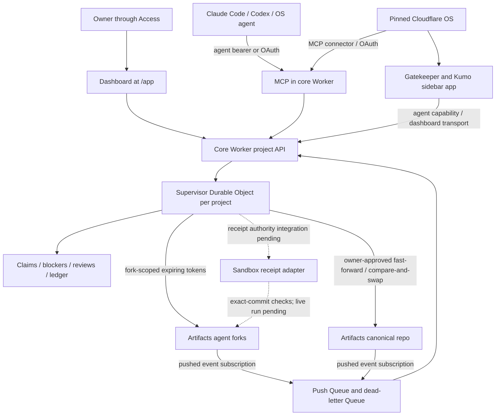

# Fork Horse (code name)

**Multi-agent collaboration for Git, on Cloudflare.**

Fork Horse is a collaboration layer for several AI agents working on one Git project: each agent works in its own Artifacts fork, claims packet paths, and submits an exact commit for owner review and promotion. It pairs a core Worker and per-project supervisor Durable Object with MCP and an owner dashboard, alongside a pinned, unmodified Cloudflare OS. Every owner deploys an instance to their own Cloudflare account; there is no central service.

The current name and tagline above come from [brand.json](brand.json), the naming authority for this repository.

## Live versus roadmap

Status as of **2026-10-12, 16:43 ET**, from the project board's operator and design acceptance records. These live checks cover the project's owner-operated instance; each new owner must verify their own deployment. An accepted implementation or passing fixture suite does not establish a live service.

| Piece | Status | Evidence and remaining acceptance |
| --- | --- | --- |
| Pinned Cloudflare OS deployment | **live** | FH-002/FH-016: OS deployed; Access sign-in and Admin Gatekeepers verified (09:39 and 10:50 ET). The router is the OS deployment's public entry point. |
| Core at `<mcp host>` | **live** | FH-012L: project creation, join, fork clone/push and push-to-activity verified (09:38 ET). Later deployments rechecked endpoint authorization. |
| MCP and OAuth | **live** | A Cloudflare OS agent called `get_context` through OAuth and core (10:56 ET). Codex `get_context` was verified separately (14:16 ET); this does not establish Codex OAuth login. |
| Owner dashboard at `<mcp host>/app` | **live** | FH-012L/FH-019: Access redirect verified; FH-026's live look verified the `/app` favicon (15:48 ET). Owner actions remain Access-protected. |
| Cloudflare OS gatekeeper and Kumo sidebar app | **live** | FH-008/FH-019: installed; real project data and Overview, Work, Review and Agents UI verified in production, including light/dark theme switching (14:12–14:16 ET). |
| Per-repository push events | **live** | FH-018: core created a new fork's subscription, and its push appeared in activity about six seconds later (10:18 ET). Canonical push delivery was verified during import and promotion. |
| Claims, review, approve and compare-and-swap promote | **live** | Import and FH-024 exercised the authorized fork-to-canonical flow, owner approval and fast-forward promotion with ledger entries (13:30 and 15:20 ET). Receipt enforcement remains separate work. |
| Self-hosting | **live** | GitHub history imported unchanged; canonical and GitHub `main` verified identical at `f257a65` after the reviewed sync (16:23 ET). See [how the project built itself](#how-fork-horse-built-itself). |
| Activity path capping | **live** | FH-024: `/activity` and `/state` serve legacy 203/205-path entries as 50 paths with the original count and truncation flag (15:20 ET); blocker detection still uses the full diff. |
| Placeholder 🐎 mark | **live** | FH-026: Admin tiles, Connect dialog, fork resource and `/app` favicon verified (15:48 ET). The existing sidebar rail icon is cached until the account reconnects; that reconnect is deferred. |
| Sandbox receipt adapter | **built, offline** | FH-007: labeled mocked container-port tests. Live container receipts await FH-032L; no passing receipt is claimed for the live promotions above. |
| Layout, reconnect and loading follow-ups | **in progress** | FH-027: follow-ups from the live Kumo UI review; no new live acceptance yet. |
| Core receipt integration | **in progress** | FH-032: review-triggered checks, storage, receipt enforcement and pre-promote rechecks are being built offline. FH-032L is the separate live gate. |
| Federation between owner instances | **roadmap** | No cross-instance service or protocol shipped. |
| Mac execution lane and native app | **roadmap** | Current project scope is cloud-only; upstream OS features do not establish these project features. |
| Gadget and blueprint | **roadmap** | FH-009: held should-tier work. |
| Quick-tier checks | **roadmap** | FH-010: held should-tier work. |
| xterm read-only test log | **roadmap** | FH-011: held should-tier work. |

## How Fork Horse built itself

The owner imported GitHub `main` into an Artifacts agent fork without rewriting history, then requested review, approved it and promoted it to canonical `main`. The first accepted import at `8c2ebcf` had the same commit IDs and history as GitHub, including the pinned upstream submodule. Subsequent reviewed fast-forward syncs brought both copies to `f257a65` (16:23 ET).

**FH-024 was the first packet built entirely through this workflow.** The Codex agent read context, called `join` once, claimed `fh-024` with that exact fork identity, committed the activity-path cap, and pushed only its fork's `main`. After fresh-clone checks, it requested review of the exact head. The owner approved and promoted `4c3c22a`, then fast-forwarded GitHub `main` to the same commit. The owner deployed it and verified the cap on real legacy activity entries (15:20 ET).

Packet commits follow this provenance convention, including any merge commits:

```text
🐎 Describe the packet change

Fork-Horse-Packet: <packet id>
Fork-Horse-Agent: <agent id>
```

Use the configured Git identity. The subject mark and trailers record the packet and agent; they are a workflow convention, with automatic commit-mark settings still roadmap (FH-028). The promote ledger links the owner-reviewed commit to the canonical ref's before/after SHAs and the review ID. Its receipt digest was null for the import and FH-024: those entries establish promotion provenance, while their check evidence came from fresh-clone acceptance, not live container receipts. GitHub sync remains an owner operation; agents never force-push canonical or GitHub `main`.

## Architecture

The core Worker hosts the project API, OAuth-wrapped MCP endpoint and Access-protected `/app` dashboard. Its supervisor serializes each project's claims and promotions. Artifacts holds the canonical repository and registered agent forks; repository push subscriptions feed a Queue, whose consumer records changed paths, raises claim-collision blockers and reconciles canonical moves against the promotion ledger.



A claim binds a packet, agent and fork immutably. Owner approval binds the review's SHA and receipt digest; promote re-reads the heads, checks fast-forward ancestry, and pushes against the captured canonical base with compare-and-swap. Blockers currently record collisions; core does not make them an additional approval gate. The receipt adapter defines exact-commit container checks and bounded logs, but its execution triggers, trusted storage, default passing-receipt requirement and pre-promote rerun are **not wired into core**. See the [core contract](packages/forkhorse-core/README.md), [integration guide](docs/core-integration.md) and [runner integration requirements](packages/forkhorse-runner/README.md#fh-005-integration-dependencies-not-implemented-here).

## Deploy your own instance

Use these owner-operated instructions to deploy your own instance. The live records above do not verify a new owner's configuration. Use Node.js 24.19 or newer and pnpm 11.17. Keep the reviewed submodule pin unchanged.

```sh
git clone --recurse-submodules https://github.com/coleprice/forkhorse.git
cd forkhorse
pnpm install --frozen-lockfile
pnpm --dir cloudflare-os install --frozen-lockfile
cp deployment.jsonc deployment.local.jsonc
```

1. Fill in the **gitignored** `deployment.local.jsonc`; keep [deployment.jsonc](deployment.jsonc) as the public template. Set OS routing, Access and storage values. For core, set `core.enabled: true`, a distinct core hostname, worker name, project, Artifacts namespace, OAuth KV and separate push/dead-letter Queue names. Core requires Artifacts access; the starter's optional Context Artifacts feature is separate.
2. Configure the OS Access application for its public hostname. Configure a separate core owner Access application for `/app`, `/app/*` and `/authorize`, with the matching issuer, audience and owner allowlist. Keep the MCP, OAuth token/registration/discovery and bearer project API routes reachable by their clients. Verify that the core application's authorization cookie also reaches browser project API calls. Follow the exact [Access and routing contract](docs/core-integration.md#access-and-routing).
3. Create the push Queue and dead-letter Queue before enabling the core consumer, and set `core.pushQueueId` to the resolved push Queue ID. Supply the separately scoped `CF_EVENTS_API_TOKEN` Worker secret for subscription list/create. Core provisions `artifacts.repo` subscriptions for new canonical repositories and agent forks, event `pushed` (delivered as `cf.artifacts.repo.pushed`); inspect `events: "active"` and verify actual delivery. Existing repositories need owner inventory/backfill. See [per-repository subscription requirements](docs/core-integration.md#per-repository-push-subscriptions).
4. Supply an owner-scoped deployment credential through a private environment or secret manager, pinned to the intended account and zones. Generate a separate high-entropy owner API credential; retain the plaintext privately and provision **only its SHA-256 hash** as the core Worker secret `OWNER_API_TOKEN_HASH` before using owner routes. Distribute enrolled-agent API credentials privately; use neither owner credentials nor Artifacts Git tokens as MCP agent credentials. No credential, hash or real deployment value belongs in tracked files.
5. Validate the owner configuration, then deploy:

   ```sh
   pnpm check
   pnpm deploy
   ```

   `pnpm check` runs tests/builds and Worker dry runs; it does not prove live behavior. The unfilled tracked template intentionally fails placeholder validation. `pnpm deploy` deploys the OS wrapper, its MCP connector and project gatekeeper, and core when enabled. The receipt runner remains separate integration work (FH-032). See the [starter deployment instructions](#deploy) and [core integration guide](docs/core-integration.md).
6. Complete the [OS verification checklist](#4-verify-the-deployment). Use the [owner API contract](packages/forkhorse-core/README.md#http-contract) to create the configured project and enroll agents, then add its repo subscriptions. Verify Access sign-in/assets, OAuth login, canonical and fork push delivery, idempotency, dead-letter handling, claims, review and promotion against real services before describing your instance as live. Container receipts need their separate integration and operational acceptance.

For offline development, run `pnpm test` and `pnpm lint`. The [dashboard fixture instructions](packages/forkhorse-dashboard/README.md#run-and-check) provide a labeled local UI; fixture approval and promotion operate only on its fictional API.

## Connect agents

Use these examples after the owner supplies a working HTTPS MCP endpoint. `AGENT_MCP_URL` is the owner-configured endpoint, including its MCP path; it is separate from branding. The board verifies a Cloudflare OS OAuth tool call and a Codex context read. Each client connection still needs its own verification.

### Claude Code

Register a Streamable HTTP server and complete OAuth through `/mcp` in Claude Code; owner Access consent enrolls a fresh agent for the grant:

```sh
claude mcp add --transport http --scope local packet_agent "$AGENT_MCP_URL"
```

This command contains no credential. Follow [Claude Code's MCP and authentication instructions](https://code.claude.com/docs/en/mcp), and use the repository's [task-packet skill](skills/forkhorse/SKILL.md) for the join/claim/review workflow.

### Codex

For an already enrolled agent, put the following in your local Codex `config.toml` and replace the endpoint placeholder locally. Supply `AGENT_CORE_API_TOKEN` through the Codex process environment:

```toml
[mcp_servers.packet_agent]
url = "<OWNER_CONFIGURED_HTTPS_MCP_ENDPOINT>"
bearer_token_env_var = "AGENT_CORE_API_TOKEN"
```

For OAuth, omit `bearer_token_env_var`, then run `codex mcp login packet_agent`. See [the Codex connection guide](docs/agents/codex.md) and [official OpenAI MCP documentation](https://developers.openai.com/codex/mcp). Never put a credential value in the TOML file.

### Cloudflare OS

Once the owner has deployed and enabled its MCP connector, add the owner-provided HTTPS MCP URL through that connector and complete OAuth/Access consent. The [pinned upstream MCP connector](cloudflare-os/packages/gatekeeper-mcp/README.md#how-the-connect-flow-works) describes discovery, registration and PKCE. This repo's deploy wiring provisions that connector (FH-016) and the dedicated project gatekeeper/sidebar app (FH-008). The OAuth path has a verified live `get_context` call; the dedicated sidebar has verified live project data and Kumo UI. Attach the connection to the agent's workspace before requesting tools.

After connecting any client, verify the seven agent tools: `get_context`, `join`, `claim`, `request_review`, `submit_work`, `status`, `activity`. Call `join` once for the packet, pass its returned `repoName` explicitly to claim, work within the packet paths, and request review for the exact resulting SHA. Refresh an expired token on the same fork; never join again to refresh it. After the owner records promotion, release your claim if it remains live. See the [task-packet skill](skills/forkhorse/SKILL.md) for the token and release routes. Owner enrollment, approval and promotion are not agent tools.

## Security model

- **Agent isolation:** authenticate and authorize before minting Artifacts tokens. Git tokens are short-lived and scoped to a registered agent fork. Enrolled-agent API credentials are a separate credential class, stored hashed; owners control rotation and fork-token revocation.
- **Canonical authority:** the canonical write token stays inside owner-only promote, is used for one compare-and-swap push, and is revoked afterwards. Canonical pushes never use force.
- **Owner boundary:** signed Access JWTs, exact issuer/audience, time claims and an explicit allowlist protect browser owner access. Browser writes also check origin and JSON content type; the dashboard receives no owner API token. MCP grants authorize agent tools only.
- **Secret handling:** owner values stay in `deployment.local.jsonc`, Worker secrets or private credential delivery. Never commit tokens, account values, personal details or machine paths. Raw Git HTTP requests send a git-style `User-Agent`.

## Limits and known gaps

- FH-027's layout, reconnect and loading follow-ups remain in progress. The OS sidebar rail retains its cached icon until the account reconnects; the deferred reconnect does not change the live mark on the other verified surfaces.
- **Checks are not currently enforced by core.** Core can approve a review with a null receipt digest; null means no check evidence. The runner's default-required receipt validator exists separately. Review-trigger execution, durable receipt attachment, default enforcement, pre-promote execution and large-repository sandbox Git remain open integration work.
- MCP is POST/JSON Streamable HTTP, with seven tools, a 25-second call deadline and responses strictly below 1 MiB; there is no persistent GET/SSE session. Server-side commits accept at most 200 text files within a bounded 1 MiB request; they do not delete files.
- Core's current Git transport bounds requests/responses to 8 MiB and its ephemeral filesystem to 32 MiB. Oversized operations fail closed; transient decompression is not fully bounded. This is not a large-repository execution lane.
- New forks provision their own event subscriptions; pending subscriptions need inspection, and older repositories need owner backfill. Blockers and historical alerts are retained, state arrays are mostly unpaged, and the core dashboard has no server WebSocket endpoint or command-log receipt API. The OS sidebar uses the gatekeeper's live capability relay.
- Uncertain project creation, token revocation or promotion outcomes can require owner inspection. Client timeouts do not undo accepted writes: inspect state/activity before retrying. OAuth grants have expiry/rotation constraints described in the [MCP contract](packages/forkhorse-mcp/README.md#oauth-and-owner-consent).
- Quick-tier checks, gadget/blueprint, read-only terminal logs and an interactive shell remain future work. Federation, the Mac lane and the native app are roadmap.

## License and credits

This repository is licensed under [Apache-2.0](LICENSE). [NOTICE](NOTICE) records its origins and attribution: deployment tooling from [cloudflare-os-starter](https://github.com/cloudflare/cloudflare-os-starter), with history preserved, and an unmodified pinned [Cloudflare OS](https://github.com/cloudflare/cloudflare-os) submodule. The project uses Cloudflare Workers, Durable Objects, Artifacts and the MCP ecosystem; it is independent and not endorsed by Cloudflare or the Git trademark holder.

---

## Cloudflare OS starter deployment reference

The original starter instructions below are preserved. Apply deployment values to the ignored local overlay described above; the template remains public-safe. These instructions cover the OS base and its example custom gatekeeper, while core prerequisites and open gates are covered above.

<p align="center">
  
</p>

<h1 align="center">Customized for your Company</h1>

<p align="center">
  Deploy a pinned Cloudflare OS release with branding, sign-in, integrations, routes, and upgrades under your control.
</p>

<p align="center">
  <a href="https://developers.cloudflare.com/workers/"></a>
  <a href="https://nodejs.org/"></a>
  <a href="https://pnpm.io/"></a>
  <a href="https://www.typescriptlang.org/"></a>
  <a href="https://github.com/cloudflare/cloudflare-os"></a>
</p>

> [!IMPORTANT]
> Cloudflare OS is early-access software. Pin upstream releases, review changes, and verify the trust boundary before every production upgrade.

## Four steps

1. Install the dependencies and run `pnpm exec wrangler login`.
2. Fill in `deployment.jsonc`: account ID, Worker names, hostname, Access audience, admin emails.
3. Run `pnpm check`, then `pnpm deploy`.
4. Open `/admin` and set the site name, logo, and accent color; branding needs no redeploy.

[Deploy](#deploy) and [Customization](#customization) expand each step. Everything else on this page is optional reading.

## Overview

This repository adds deployment controls around a pinned [Cloudflare OS](https://github.com/cloudflare/cloudflare-os) release without modifying the upstream source.

| Control | What you own |
| --- | --- |
| Branding | Site name, logo, and accent color, changed in [`/admin`](docs/customization.md#branding) without a deploy |
| Identity | The sign-in method and administrator allowlist; this starter deploys [Cloudflare Access](https://developers.cloudflare.com/cloudflare-one/access-controls/applications/http-apps/self-hosted-public-app/) mode |
| Routing | A production [Custom Domain](https://developers.cloudflare.com/workers/configuration/routing/custom-domains/) or a `workers.dev` evaluation route |
| Data | Existing KV/R2 resources or [automatic provisioning](https://developers.cloudflare.com/workers/wrangler/configuration/#automatic-provisioning) |
| Integrations | Wrapper-owned Gatekeepers and service bindings without patching upstream |
| AI | A [Workers AI](https://developers.cloudflare.com/workers-ai/) model catalog through [AI Gateway](https://developers.cloudflare.com/ai-gateway/) out of the box, with no API token; which providers and which gateway |
| Operations | [Structured logs, traces, explicit error reports](docs/observability.md), validation, deployment order, and upgrades |

### Architecture


The deployment is six Workers. A **router** owns the public route and serves the frontend, proxying `/api` to the Workshop backend and `/gatekeeper/<name>` to whichever Gatekeeper the binding name matches; the Workshop, the Context, Scheduler and custom Gatekeepers, and the Error Reporter sit behind it with no route of their own, reachable only over service bindings.

The deploy command derives temporary Wrangler files from upstream base configs, builds the frontend in Cloudflare Access mode, deploys the private Error Reporter, the Gatekeepers and the Workshop before the router that binds them, and removes generated files even on failure. Secrets never enter tracked configuration.

### If you only want branding

A hosted flow deploys the same upstream release to your Cloudflare account without this repository. It builds nothing locally, configures sign-in and your admin emails for you, and leaves the whole `/admin` surface intact: site name, logo, accent color, announcements, agent instructions, featured blueprints, and which connectors your users can reach. Built-in Gatekeepers such as GitHub and Google are still yours to connect with your own OAuth credentials.

<a href="https://os.cloudflare.app/deploy"></a>

Anything past that needs your own code or settings, which is what this repository is for: custom Gatekeepers, customized error reporting, your own Worker names, reusing storage you already have, choosing how much logging to keep, and a pinned version you upgrade when you decide. Hosted deployments also run on a `workers.dev` address, so deploy from here if you want the app on your own domain, or the email Gatekeeper, which needs a zone. Come back when branding stops being enough.

## Deploy

### 1. Prepare the workspace

Install [Node.js 24.19 or newer](https://nodejs.org/) (the deploy scripts are TypeScript run directly by `node`), [pnpm 11.17](https://pnpm.io/installation), and authenticate [Wrangler](https://developers.cloudflare.com/workers/wrangler/commands/#login):

```sh
git submodule update --init
pnpm install
pnpm --dir cloudflare-os install
pnpm exec wrangler login
```

Your account needs [Workers](https://developers.cloudflare.com/workers/), [KV](https://developers.cloudflare.com/kv/), [R2](https://developers.cloudflare.com/r2/), [Browser Rendering](https://developers.cloudflare.com/browser-rendering/), and [Dynamic Worker Loaders](https://developers.cloudflare.com/workers/runtime-apis/bindings/worker-loader/). It also needs [Workers AI](https://developers.cloudflare.com/workers-ai/) and [AI Gateway](https://developers.cloudflare.com/ai-gateway/), which the default model catalog runs on; only turning that catalog off makes them dispensable. [Artifacts](https://developers.cloudflare.com/artifacts/) is optional.

### 2. Configure sign-in

Cloudflare OS supports several sign-in methods. This starter deploys [Cloudflare Access](https://developers.cloudflare.com/cloudflare-one/access-controls/applications/http-apps/self-hosted-public-app/) mode, which verifies identity before a request reaches the Worker. See [Sign-in methods](docs/customization.md#sign-in-methods) for the alternatives and what switching involves.

1. Choose a public hostname in an [active Cloudflare zone](https://developers.cloudflare.com/dns/zone-setups/), such as `os.example.com`.
2. Create a [self-hosted Access application](https://developers.cloudflare.com/cloudflare-one/access-controls/applications/http-apps/self-hosted-public-app/) for that hostname.
3. Copy its [application audience tag](https://developers.cloudflare.com/cloudflare-one/access-controls/applications/http-apps/authorization-cookie/validating-json/#get-your-aud-tag).
4. Open [`deployment.jsonc`](deployment.jsonc) and replace the active placeholders. Every control is annotated in place.

The hostname belongs to the router, the only Worker here with a public route. Wrangler creates its DNS and TLS at deploy time. For an evaluation without a zone, switch the annotated route to `{ "workersDev": true }` and set `publicBaseUrl` to the resulting origin.

### 3. Validate and deploy

```sh
pnpm check
pnpm deploy
```

With resource values left as `null`, Wrangler creates the three KV namespaces and R2 bucket automatically and reconnects them on later deploys. Set explicit IDs or a bucket name when the deployment must reuse existing resources.

A Workers AI model catalog is enabled by default and needs no API token: the Workshop reaches AI Gateway over its `WORKERS_AI` binding, which is pre-authenticated inside your account. See [AI models](docs/customization.md#ai-models) to add providers, change the gateway, or turn the catalog off.

Git-backed Context collections are disabled by default. Accounts with Artifacts access can enable them in `context.artifacts`; see [Context Artifacts](docs/customization.md#context-artifacts).

Backend error reporting is enabled without a vendor account. Explicit upstream issue events become structured logs in the private Error Reporter Worker; see [Observability and error reporting](docs/observability.md).

### 4. Verify the deployment

- Open the router's hostname and confirm Access signs in with the expected identity, and that it is the only public route into the deployment.
- Open `/admin`, confirm the email is an administrator, and set Context, Scheduler and Custom Gatekeepers to disabled, optional, or enabled.
- If Context Artifacts is enabled, create a Git-backed collection and confirm its repository can be populated and refreshed.
- Enable the Custom Gatekeeper, ask for deployment information, and confirm its read appears as an observation.
- Open the Error Reporter Worker's [Workers Logs](https://developers.cloudflare.com/workers/observability/logs/workers-logs/) and verify its structured `error_report` query surface.
- Ask an agent to schedule something a few minutes out, and confirm it runs — that exercises the Scheduler Gatekeeper end to end.
- Review logs for the router, Workshop, Context, Scheduler, custom Gatekeeper, and Error Reporter Workers.

## Customization

| Customize | Best place | Deploy required |
| --- | --- | --- |
| Site name, logo, color, announcements, instructions, connectors | `/admin` | No |
| Sign-in, routes, AI, storage, observability, Worker identities | [`deployment.jsonc`](deployment.jsonc) | Yes |
| Logs, traces, error destinations, browser reporting | [Observability guide](docs/observability.md) | Sometimes |
| Organization APIs and capabilities | [`packages/custom-gatekeeper`](packages/custom-gatekeeper/README.md) | Yes |
| Product behavior unavailable through Worker boundaries | Pinned upstream fork/commit | Yes |

The complete control reference and recipes live in [Customization](docs/customization.md). The upstream [`write-gatekeeper` skill](https://github.com/cloudflare/cloudflare-os/blob/main/.agents/skills/write-gatekeeper/SKILL.md) covers richer integrations.

## Operations and upgrades

- Stream production events with [`wrangler tail`](https://developers.cloudflare.com/workers/observability/logs/real-time-logs/).
- Triage explicit failures and choose export destinations with the [observability guide](docs/observability.md).
- Roll a Worker back from its dashboard deployment history or with [`wrangler rollback`](https://developers.cloudflare.com/workers/versions-and-deployments/rollbacks/).
- Follow the [upgrade checklist](docs/customization.md#upgrade) before changing the pinned submodule.
- Review the upstream Cloudflare OS documentation and release history before adopting behavior changes.

### Moving here from the hosted deploy (os.cloudflare.app/deploy)

Ejecting an instance created by the hosted flow means redeploying over Workers that already hold your data. Worker names, storage IDs, the public URL, and AI Gateway all have to be carried across by hand, and each one fails quietly if it is not: the deploy succeeds against empty storage. [Migrating from the hosted deploy](docs/migrate-from-hosted.md) is the checklist.
