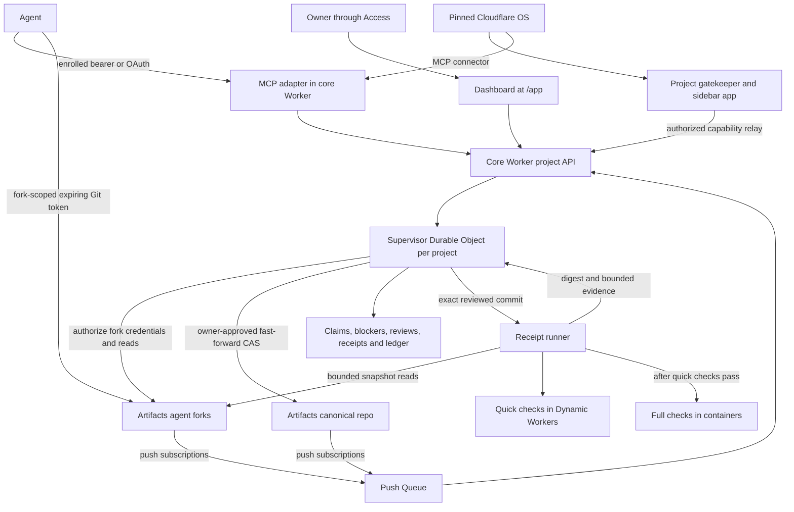

# Fork Horse architecture

Fork Horse adds multi-agent Git collaboration to a pinned, unmodified Cloudflare OS. Each owner deploys their own Workers, storage and Artifacts repositories; no central service coordinates instances. [brand.json](../brand.json) supplies the code name and slug `forkhorse`. The [quickstart](quickstart.md) follows one packet through this system.

The **core Worker** authenticates project API requests, mounts MCP/OAuth, serves the dashboard and consumes push events. The **Supervisor Durable Object** serializes each project's claims and promotions and persists reviews, receipts and the ledger. A claim binds a packet, agent and fork. Standard packets exclude conflicting claims; race entrants may overlap. Open collision blockers gate the trespassing review. See the [core contract](../packages/forkhorse-core/README.md).

**Artifacts** holds canonical `main` and agent forks. Agents receive short-lived fork-scoped credentials; the canonical write credential stays inside promote. Owner approval binds an exact review. Promotion verifies the heads, fast-forward ancestry and canonical base before a compare-and-swap push. A stale base refuses the write. Success records provenance and releases the matching claim; a race also records its winner and closes other entries.

**MCP** exposes agent tools, including review requests, resume hints, race standings and same-fork token refresh. Enrollment, approval and promotion remain owner operations. The **project gatekeeper** relays authorized project data/actions to the Cloudflare OS sidebar; the OS MCP connector separately reaches the agent tools. Access protects browser owner actions. See [MCP](../packages/forkhorse-mcp/README.md), [gatekeeper](../packages/forkhorse-gatekeeper/README.md) and [Access/routing](core-integration.md#access-and-routing).

**Receipts** bind checks to the reviewed commit. Quick checks run in fresh Dynamic Workers with bounded snapshot capabilities and no outbound network. Passing quick checks allow full checks in containers with owner-approved immutable images and an exact checkout. Required mode gates approval and reruns checks before promote; advisory mode records results without gating it. Public state carries summaries; bounded logs are owner-only. See [receipts](receipts.md) and [large files](large-files.md).

The [dated acceptance table](../README.md#live-versus-roadmap) supersedes older pending notes for its listed features: real container receipts (2026-10-12 18:54 ET), Dynamic Workers (2026-10-13 06:39 ET), race finishes (11:59 ET) and reported-budget enforcement (17:39 ET). Deployment and fixtures remain separate from live checks. Automatic judge verdicts are pending acceptance; usage is not independently metered. Federation, a Mac execution lane and a native app remain roadmap.
